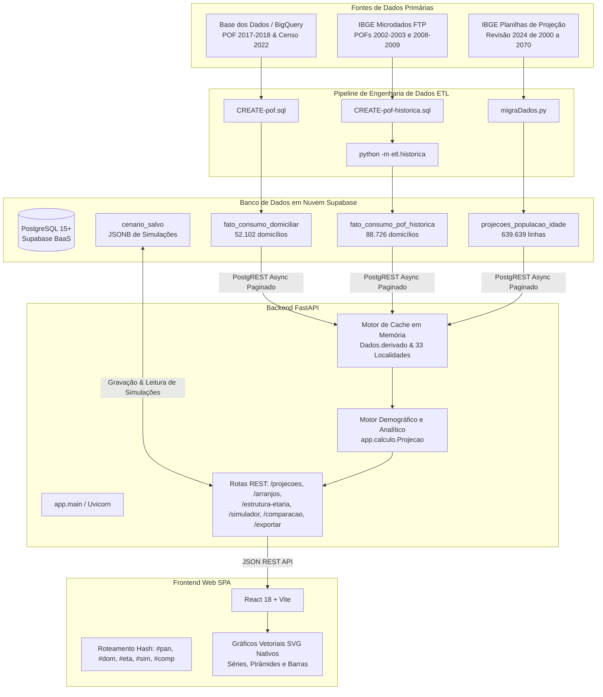
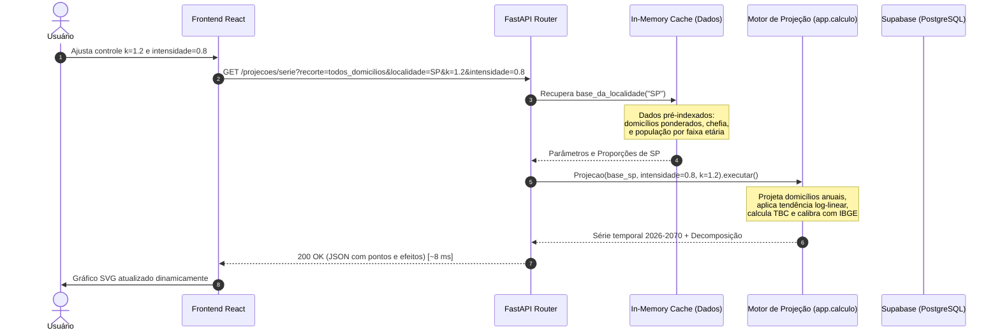
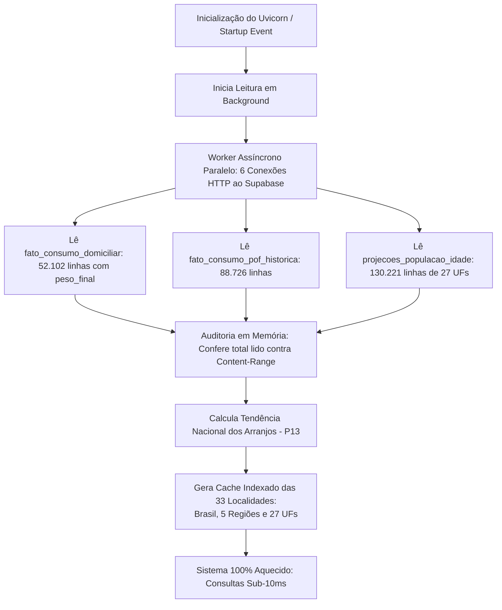

# Arquitetura do Sistema

A arquitetura do **PROCED** foi desenhada para atender a dois requisitos centrais aparentemente contraditórios:

1. **Rigor Científico e Demográfico:** Processamento de microdados com planos amostrais complexos (POF), interpolação censitária (Censo 2022) e séries demográficas de longo prazo do IBGE com projeções até 2070.
2. **Alta Performance e Interatividade em Tempo Real (RNF02):** Resposta imediata (sub-10ms em consultas de série temporal e sub-2ms em composições após aquecimento) na manipulação de múltiplos filtros e controles de simulação no navegador.

Para atingir esses objetivos, o sistema adota um padrão de **Três Camadas Desacopladas** complementado por um mecanismo de **Cache e Indexação em Memória no Backend**.

---

## 1. Diagrama de Arquitetura de Alto Nível

O fluxo global de ponta a ponta compreende a camada de dados em nuvem, a camada de aplicação FastAPI, e a interface frontend SPA:

---

## 2. Diagrama de Ciclo de Vida da Requisição

Quando o usuário manipula um controle de simulação ou altera a localidade no navegador, a requisição percorre as camadas do sistema conforme o diagrama de sequência abaixo:

---

## 3. Estratégia de Inicialização, Pré-Carga e Cache em Memória

Uma das principais inovações técnicas do PROCED é a sua estratégia de **pré-carga assíncrona em memória**. 

Como o Supabase impõe um limite máximo de 1.000 linhas por requisição HTTP via PostgREST e não suporta agregação nativa via REST simples sem functions RPC, ler as tabelas em tempo real sob demanda do usuário causaria lentidão inaceitável (de 7 a 65 segundos por tela).

Para eliminar esse gargalo:

### Resultados da Otimização de Performance (Medições Reais):

| Métrica de Desempenho | Antes da Otimização | Após Pré-Carga e Cache em Memória | Ganho de Desempenho |
|---|---|---|---|
| Leitura da população das 27 UFs (130 mil linhas) | 65,6 s (em sequência) | **14,2 s** (6 workers paralelos) | **$4,6\times$ mais rápido** |
| `/projecoes/serie` (Brasil, 45 anos) | 4,44 s | **0,008 s (8 ms)** | **$555\times$ mais rápido** |
| `/projecoes/serie` (Nordeste, 45 anos) | 7,31 s | **0,008 s (8 ms)** | **$913\times$ mais rápido** |
| `/arranjos/composicao` (todas as faixas) | 0,29 s | **0,002 s (2 ms)** | **$145\times$ mais rápido** |
| `/estrutura-etaria/piramides` (2026-2070) | 1,63 s | **0,010 s (10 ms)** | **$163\times$ mais rápido** |

---

## 4. Detalhamento das Camadas do Sistema

### 4.1. Camada de Apresentação (Frontend)
* **Framework:** React 18 construído com **Vite** para empacotamento ultrarrápido (*Hot Module Replacement*).
* **Roteamento Leve:** Roteamento por *hash* nativo (`#pan`, `#dom`, `#eta`, `#sim`, `#comp`) sem frameworks pesados de roteamento externo, garantindo portabilidade para execução em qualquer servidor estático ou CDN.
* **Renderização Gráfica em SVG Puro:** Ao contrário de soluções convencionais que importam bibliotecas de terceiros como D3 ou Chart.js (que adicionam centenas de kilobytes ao bundle), todos os gráficos do PROCED (linhas temporais, pirâmides etárias, barras de consumo e sparklines) são **componentes React SVG puros**, desenhados diretamente via código matemático de coordenadas normalizadas.
* **Componentes Modulares:** Arquitetura organizada em páginas (`pages/`), componentes atômicos (`components/`), hooks customizados (`hooks/`) e serviços de comunicação (`services/`).

### 4.2. Camada de Aplicação e Serviços (Backend)
* **Framework:** **FastAPI** rodando sobre o servidor ASGI **Uvicorn**.
* **Validação de Schemas e Contratos:** **Pydantic v2** garante a tipagem estrita de cada parâmetro de consulta (`query params`), rejeitando dados fora do domínio científico (com respostas HTTP 422 padronizadas).
* **Estrutura em Camadas Claras:**
  * `routes/`: Roteadores HTTP por contexto de negócio (Panorama, Domicílios, Estrutura Etária, Simulador, Comparação, Exportação, Fontes, Localidades).
  * `services/`: Orquestradores de regras de negócio e despacho.
  * `schemas/`: Modelos Pydantic de entrada e saída.
  * `dominio.py`: Constantes, enumerações, definições das células e agrupamentos demográficos.
  * `calculo.py`: Motor matemático puro e desacoplado de dependências web.
  * `dados.py`: Camada de acesso e gerenciamento de cache em memória.

### 4.3. Camada de Persistência e Dados (Supabase)
* **SGBD:** PostgreSQL 15 hospedado no Supabase.
* **Tabelas Operacionais em Produção:**
  * `fato_consumo_domiciliar`: 52.102 microdados da POF 2017–2018 com `peso_final`.
  * `fato_consumo_pof_historica`: 88.726 microdados das POFs 2002 e 2008 para estimação da tendência de arranjos (P13).
  * `projecoes_populacao_idade`: 639.639 registros de população IBGE (2000–2070).
  * `cenario_salvo`: Tabela de persistência e aceleração de simulações em `jsonb` (RF09).
* **Tabelas Exploratórias de Baseline:**
  * `dim_coeficiente_consumo` e `consumo_estimado`: Criadas na fase inicial de exploração no BigQuery. Não são consumidas pela API nem pelo motor de projeções, pois foram geradas com médias simples (sem `peso_final`) e resolução binária de idade.
* **Segurança e Isolamento (RLS):** *Row Level Security* (RLS) habilitado em todas as tabelas. As chaves públicas (`anon`) têm acesso negado por padrão; apenas a API do backend, munida da `SUPABASE_SECRET_KEY` via conexões seguras HTTPS/TLS, tem permissão de leitura sobre as tabelas mestras e gravação exclusiva na tabela `cenario_salvo`.

---

## 5. Arquitetura de Exportação e Auditoria

A geração de arquivos em `/exportar` e `/exportar/comparacao` foi desenvolvida sem bibliotecas externas pesadas:
* **Geração CSV:** Biblioteca padrão Python `csv` formatando saídas em UTF-8 com BOM (`\ufeff`) para compatibilidade com o Excel brasileiro.
* **Geração XLSX:** Engine nativa otimizada que gera planilhas Excel estruturadas com formatação tipada de células.
* **Trilha de Auditoria:** Cada linha exportada carrega o `timestamp` de geração com fuso horário, a versão do modelo (`VERSAO_MODELO = "2026-10-14"`), os valores exatos de $k$ e intensidade empregados e a flag booleana de simulação.
