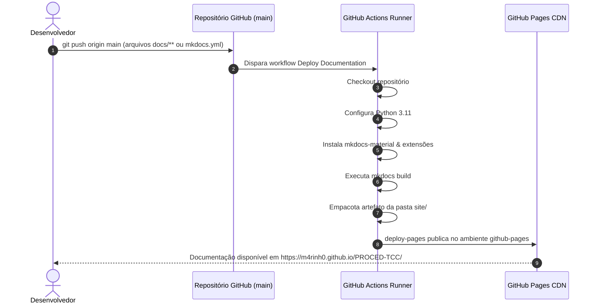

# Instalação, Desenvolvimento e CI/CD

Este guia reúne todas as instruções operacionais para configurar o ambiente de desenvolvimento local, executar o backend e o frontend, rodar as suítes de testes automatizados e publicar a documentação no **GitHub Pages** com deploy contínuo via **GitHub Actions**.

---

## 1. Pré-Requisitos

Antes de iniciar, certifique-se de possuir instalado em sua máquina:

* **Python 3.11+** (recomendado Python 3.11 a 3.13).
* **Node.js 20+** e **npm**.
* **Git**.
* Conta no **Supabase** com acesso ao projeto do banco de dados relacional.

---

## 2. Como Clonar e Configurar o Repositório

```bash
git clone https://github.com/M4RINH0/PROCED-TCC.git
cd PROCED-TCC
```

---

## 3. Configurando o Back-end (FastAPI)

Abra um terminal dedicado para o backend:

```bash
cd backend
python -m venv .venv

# No Linux / macOS:
source .venv/bin/activate

# No Windows (Git Bash):
# source .venv/Scripts/activate
# No Windows (PowerShell):
# .venv\Scripts\Activate.ps1

pip install -r requirements.txt
```

### Configuração das Variáveis de Ambiente (`.env`)

Copie o arquivo de exemplo:

```bash
cp .env.example .env
```

Edite o arquivo `backend/.env` e preencha as variáveis do Supabase:

```ini
SUPABASE_URL=https://seu-projeto.supabase.co
SUPABASE_SECRET_KEY=sua-chave-secreta-de-servico
```

> [!CAUTION] Segurança das Chaves
> A `SUPABASE_SECRET_KEY` possui privilégios de bypass de RLS para alimentar o cache do backend e gravar simulações. **Nunca comite o arquivo `.env` no Git.**

### Executando a API

```bash
uvicorn app.main:app --reload
```

* **API REST:** `http://localhost:8000`
* **Swagger UI / Documentação Interativa:** `http://localhost:8000/docs`
* **Redoc:** `http://localhost:8000/redoc`

Ao subir, o backend executa em segundo plano a leitura assíncrona das tabelas do Supabase por cerca de 10 a 14 segundos para aquecer o cache em memória.

---

## 4. Configurando o Front-end (React + Vite)

Abra um segundo terminal dedicado para a interface:

```bash
cd frontend
npm install
cp .env.example .env
npm run dev
```

* **Interface Web:** `http://localhost:5173`

> [!NOTE] Porta do Frontend
> O frontend deve rodar obrigatoriamente na porta `5173`, pois esta é a origem explicitamente autorizada na política de CORS do FastAPI (`backend/app/main.py`).

---

## 5. Executando as Suítes de Testes

O projeto conta com baterias completas de testes unitários e de integração:

### Testes do Backend e ETL (pytest):
```bash
cd backend
pytest
```
* Valida todas as rotas da API via `TestClient`.
* Confere regras de negócio de derivação, decomposição e calibração.
* Testa a robustez do pipeline de projeção.

### Testes do Frontend (Vitest + React Testing Library):
```bash
cd frontend
npm test
```
* Executa testes de renderização de componentes React em ambiente DOM simulado com `jsdom`.

---

## 6. Documentação Local com MkDocs

Para visualizar e editar esta documentação em tempo real no seu computador:

```bash
# Instale as ferramentas de documentação (no ambiente virtual do backend ou global):
pip install mkdocs-material pymdown-extensions

# Inicie o servidor local de documentação com live reload:
mkdocs serve
```

Acesse `http://localhost:8000` (ou a porta informada pelo terminal) para navegar pela documentação.

Para compilar os arquivos estáticos:
```bash
mkdocs build
```
Os arquivos HTML compilados serão gerados na pasta `site/` (devidamente ignorada pelo Git).

---

## 7. Deploy Automático no GitHub Pages (CI/CD)

A publicação no **GitHub Pages** é totalmente automatizada através do GitHub Actions configurado em [`.github/workflows/deploy-docs.yml`](https://github.com/M4RINH0/PROCED-TCC/blob/main/.github/workflows/deploy-docs.yml).

### Fluxo do CI/CD:



### Configuração Inicial no Repositório do GitHub:

Para ativar o GitHub Pages pela primeira vez no repositório:
1. Acesse o repositório no GitHub: `https://github.com/M4RINH0/PROCED-TCC`.
2. Vá em **Settings** > **Pages** (no menu lateral esquerdo).
3. Na seção **Build and deployment**:
   * **Source:** Selecione **GitHub Actions**.
4. A cada novo commit ou merge na branch `main`, a Action construirá a versão mais recente e fará o deploy em poucos segundos!
