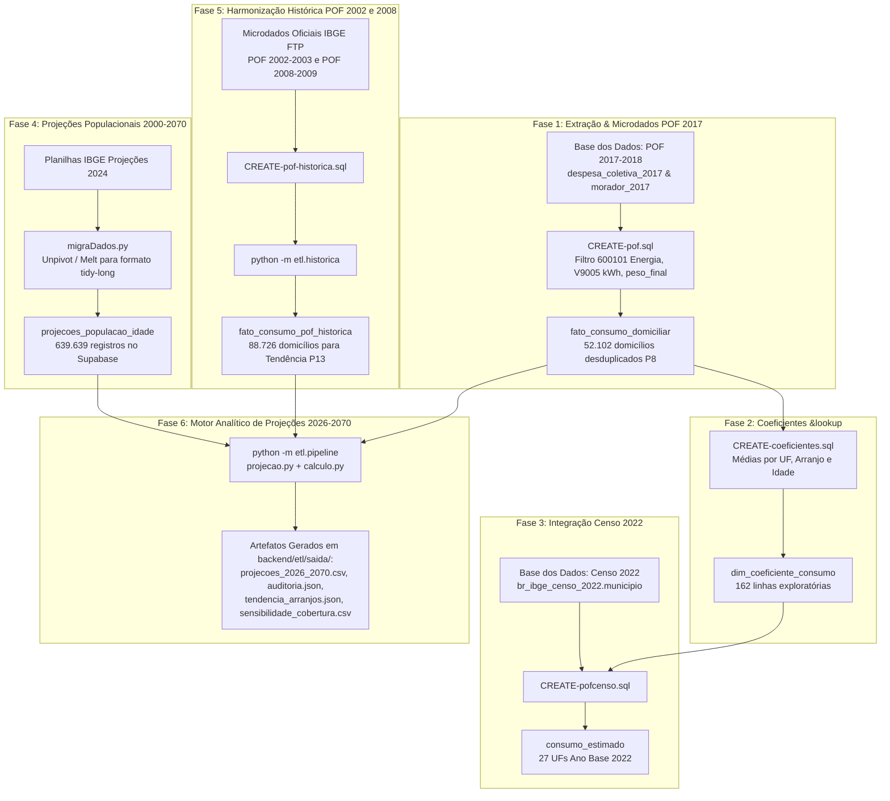

# ETL e Engenharia de Dados

Este documento descreve a engenharia de dados realizada para o projeto **PROCED**, integrando microdados amostrais de três edições da Pesquisa de Orçamentos Familiares (POF 2002-2003, 2008-2009 e 2017-2018), dados universais do Censo Demográfico 2022 e as Projeções Oficiais da População do Brasil (Revisão 2024 até o ano 2070).

---

## 1. Visão Geral do Pipeline de Dados

O pipeline de dados opera em ambientes distribuídos (Google BigQuery e Supabase PostgreSQL), complementado por scripts de pré-processamento e projeção em Python:



---

## 2. Passo a Passo do ETL

### Fase 1: Extração e Consolidação de Microdados da POF 2017-2018

* **Objetivo:** Criar a tabela `fato_consumo_domiciliar` com granularidade de domicílio único.
* **Mapeamento de Fontes:** Extração das tabelas `morador_2017` e `despesa_coletiva_2017` do diretório público `basedosdados.br_ibge_pof`.
* **Identificação do Item de Energia:** Localização do código de produto `600101` (Energia Elétrica) na variável `V9001`.
* **Consumo em kWh e Gasto em R$:**
  * O consumo elétrico físico mensal decorre da variável `V9005` (Quantidade consumida em kWh).
  * O valor despendido mensalmente é obtido por `V8000_deflacionado`.
* **Filtragem de Pessoa de Referência (Chefe):**
  * Aplicação do filtro hierárquico `V0306 IN ('01', '1')` para isolar os chefes de família.
* **Inclusão do Fator de Expansão Amostral (`peso_final`):**
  * O plano amostral da POF é estratificado e conglomerado em múltiplos estágios. A incorporação do `peso_final` calibrado com pós-estratificação é obrigatória (Premissa P3) para corrigir o viés da amostra e permitir a expansão estatisticamente representativa para a população brasileira.
* **Critério de Exclusão Metodológico:**
  * Foram excluídos os domicílios sem declaração válida de consumo elétrico (onde a variável `V9005` estava nula ou inexistente), totalizando cerca de 6 mil registros descartados na extração. Na tabela final, nenhum domicílio possui consumo nulo ou zero (o menor consumo registrado é de 13 kWh/mês). A soma dos pesos amostrais totaliza **63,68 milhões de domicílios**, conferindo uma cobertura de **92,4%** dos 68,9 milhões de lares estimados pelo IBGE para a POF 2017-2018 (Premissa P9).
* **Desduplicação de Unidades de Consumo (Premissa P8):**
  * Na POF, um mesmo domicílio físico pode abrigar mais de uma Unidade de Consumo (UC), cada qual com sua respectiva pessoa de referência. Isso gerava 99 `id_domicilio` repetidos em 204 linhas, com consumos, pesos e moradores idênticos. O pipeline desduplica mantendo estritamente a linha da pessoa de referência de maior idade, fixando a tabela fato em **52.102 domicílios únicos**.

---

### Fase 2: Cálculo dos Coeficientes de Consumo (`dim_coeficiente_consumo`)

* **Objetivo:** Gerar a tabela auxiliar `dim_coeficiente_consumo` (162 linhas: 27 UFs $\times$ 3 arranjos $\times$ 2 grupos etários), criada pelo script `CREATE-coeficientes.sql`.
* **Lógica de Agrupamento:**
  * **Arranjo Familiar:** Unipessoal (Mononuclear), Casal ou Dupla, ou Multipessoal (3+ moradores).
  * **Faixa Etária do Chefe:** Flag booleana `is_60_mais` (`TRUE` para chefes $\ge 60$ anos).
  * **Localidade:** Agrupamento por `sigla_uf` (27 UFs).

> [!WARNING] Status de Uso no Projeto: Tabela Não Utilizada na API e nas Projeções
> A tabela `dim_coeficiente_consumo` **não é consumida pela API (FastAPI) nem pelo motor de projeções (`pipeline.py` e `projecao.py`)**. Ela foi concebida nas etapas exploratórias iniciais do TCC no BigQuery e foi formalmente substituída no sistema operacional pelos seguintes motivos:
> 
> 1. **Ausência de Ponderação Amostral:** Foi calculada via média aritmética simples (`AVG`), ignorando o fator de expansão populacional (`peso_final`). A **Premissa P3** do projeto estabeleceu que toda média e taxa deve obrigatoriamente ponderar pelo desenho amostral da POF para evitar viés estatístico.
> 2. **Resolução Etária Insuficiente:** A tabela estratifica a idade em apenas duas classes binárias (`is_60_mais = TRUE/FALSE`), enquanto o motor do PROCED e a API requerem **7 faixas etárias detalhadas** do chefe de família (*até 29, 30–39, 40–49, 50–59, 60–69, 70–79 e 80+ anos*), totalizando 21 células sociodemográficas por localidade.
> 
> **O que o sistema utiliza no lugar:** O backend lê diretamente a tabela `fato_consumo_domiciliar` e calcula todas as taxas em tempo de execução com `peso_final`, aplicando desduplicação de chefes (Premissa P8) e calibração demográfica com o IBGE.

---

### Fase 3: Integração Censitária com o Censo 2022 (`consumo_estimado`)

* **Objetivo:** Gerar a tabela `consumo_estimado` (27 linhas estaduais) via `CREATE-pofcenso.sql`, servindo como estudo exploratório do Ano Base 2022 ao cruzar o Censo com os coeficientes da Fase 2.
* **Dedução da População Idosa:**
  * Multiplica-se a proporção exata de idosos da distribuição etária oficial do IBGE pela população total recenseada em cada UF no Censo 2022. Essa metodologia evita a distorção do índice de envelhecimento municipal (que compara idosos com crianças de 0 a 14 anos e superestimava a proporção de idosos ao desconsiderar a faixa de 15 a 59 anos).
* **Aplicação dos Coeficientes:** Cruzamento com as médias de consumo per capita para quantificar o consumo residencial de idosos e não idosos no ano de 2022.

> [!NOTE] Status no Sistema Operacional
> Assim como a tabela de coeficientes, `consumo_estimado` é um **artefato exploratório da fase conceitual do TCC**. A API do PROCED projeta a série temporal de 2026 a 2070 diretamente a partir de `fato_consumo_domiciliar` calibrada com as projeções contínuas de população do IBGE (`projecoes_populacao_idade`), sem consultar `consumo_estimado`.

---

### Fase 4: Projeções Demográficas e Carga no Supabase

* **Objetivo:** Estruturar as projeções oficiais da população brasileira (Revisão 2024) de 2000 a 2070.
* **Processamento com `migraDados.py`:**
  * A planilha original do IBGE traz as projeções organizadas em colunas anuais (*wide format*). O script executa limpeza de cabeçalhos, filtragem de variáveis e aplica uma transformação de *unpivot* (*melt*) para converter os dados para formato longo (*tidy/long format*), gerando 639.639 linhas.
* **Carga no Supabase:** Inserção estruturada no PostgreSQL em nuvem sob a tabela `projecoes_populacao_idade`.

---

### Fase 5: Harmonização das POFs Anteriores (2002-2003 e 2008-2009)

* **Objetivo:** Alimentar a tabela `fato_consumo_pof_historica` (88.726 registros) para viabilizar a estimação empírica da transição dos arranjos familiares ao longo do tempo (Premissa P13).
* **Harmonização de Variáveis:**
  * **POF 2002-2003:** 39.458 domicílios. Consumo de energia elétrica obtido no Quadro 07, item `00202`; fator de expansão `fator`.
  * **POF 2008-2009:** 49.268 domicílios. Item `V9001 = 600201`; fator de expansão `PESO_FINAL`.
* **Carga com `python -m etl.historica`:**
  * Realiza validações de integridade, cálculo do consumo per capita e insere os registros via *upsert* paginado em lotes de 1.000 linhas na chave primária composta `(ano_pof, id_domicilio)`.
  * Registros fora da rede geral de energia (240 lares em 2002 e 88 lares em 2008) são preservados no banco, mas filtrados no cálculo pela coluna `energia_rede_geral = TRUE`.

---

### Fase 6: Pipeline de Projeção em Python (`backend/etl/pipeline.py`)

O pipeline analítico definitivo é orquestrado por `backend/etl/projecao.py` e executa 6 macroetapas:

1. **Auditoria e Validação dos Dados de Entrada (`saida/auditoria.json`):**
   * Confere contagem de linhas lidas contra o cabeçalho `Content-Range` do Supabase.
   * Valida ausência de pesos nulos ou negativos (zero ocorrências).
   * Confere se a soma das 27 UFs fecha perfeitamente com a série nacional do Brasil em todas as idades de 2018 a 2070 (diferença máxima: zero).
2. **Ponte Comum de Chefia (Premissa P2):**
   * Calcula a taxa de chefia de 2018 por faixa etária do chefe com pesos amostrais:
     $$\text{chefia}_x = \frac{\sum_{i \in x} \text{peso}_i}{\text{Pop}_{x, 2018}}$$
   * Projeta a quantidade de domicílios anuais até 2070.
3. **Tendência Histórica dos Arranjos (Premissa P13 e `saida/tendencia_arranjos.json`):**
   * Ajusta regressão linear sobre $\ln(\text{unipessoal}/\text{multipessoal})$ e $\ln(\text{casal}/\text{multipessoal})$ nas três POFs (2002.5, 2008.5 e 2017.5).
   * Aplica a intensidade ótima calibrada de $0.6$ a partir de 2026.
4. **Cálculo dos Cenários Prospectivos:**
   * `taxas`: Envelhecimento demográfico + tendência de arranjos.
   * `taxas_arranjos_fixos`: Só envelhecimento com arranjos de 2026 congelados.
   * `contrafactual`: Sem mudanças desde 2026 (distribuição por células congelada).
5. **Calibração Populacional (Premissa P12):**
   * Compatibiliza o consumo agregado com a população residente projetada pelo IBGE:
     $$\text{Consumo Calibrado} = \text{Consumo por Pessoa} \times \text{População IBGE}$$
6. **Análise de Sensibilidade:**
   * Gravação de relatórios de sensibilidade de cobertura (`saida/sensibilidade_cobertura.csv`) e de intensidade (`saida/sensibilidade_intensidade.csv`).

---

## 3. Experimento de Machine Learning

Um dos requisitos de investigação do TCC envolveu testar se modelos modernos de Machine Learning poderiam substituir ou superar a modelagem demográfica clássica. O experimento está implementado em `backend/etl/modelagem.py`.

### 3.1. Configuração do Experimento
* **Modelos Testados:**
  1. *Linha de Base (Baseline):* Média simples por célula de idade e arranjo.
  2. *Random Forest Regressor (`ml_rf`):* 100 árvores, profundidade máxima 8.
  3. *Gradient Boosting Regressor (`ml_gb`):* 100 estimadores, taxa de aprendizado 0.05, profundidade máxima 4.
* **Validação Cruzada:** 5-Fold Stratified K-Fold (semente aleatória 42) com métricas ponderadas pelo fator amostral (`peso_final`).
* **Variáveis Explicativas (*Features*):** `idade_chefe`, `qtd_moradores`, `arranjo_familiar` e `sigla_uf`.

### 3.2. Métricas Obtidas (Médias dos 5 Folds)

| Modelo | MAE (kWh/mês) | RMSE (kWh/mês) | $R^2$ Ponderado | Viés Médio (kWh) |
|---|---|---|---|---|
| **Linha de Base** | 81,56 | 121,38 | **0,066** | $-0,016$ |
| **Random Forest (`ml_rf`)** | 76,54 | 116,95 | **0,133** | $-0,960$ |
| **Gradient Boosting (`ml_gb`)** | 74,78 | 114,90 | **0,163** | $-0,303$ |

### 3.3. Importância das Variáveis por Permutação

* **Arranjo Familiar / Moradores:** Impacto médio de **7,8 a 8,2 pontos** no erro.
* **Idade do Chefe:** Impacto médio de **1,6 a 2,0 pontos** no erro.
* **Sigla da UF:** Impacto próximo de **0,0**.

### 3.4. Justificativa para Exclusão do ML da Produção (Decisão de 16/10/2026)

Em 16 de outubro de 2026, a modelagem de Machine Learning foi formalmente retirada do pipeline de projeções e da API de produção pelos seguintes motivos científicos:

1. **Baixo Poder Explicativo Incremental:** O $R^2$ obtido (0,16 no melhor modelo) indica que o consumo elétrico domiciliar possui alta variância intrínseca não captada pelas variáveis demográficas básicas (depende de renda, posse de equipamentos de ar-condicionado, isolamento térmico e hábitos).
2. **Ausência de Série Temporal Amostral:** A POF é uma pesquisa de corte transversal único (*cross-section*). Treinar um regressor em um único ponto no tempo e aplicá-lo 50 anos à frente viola premissas de generalização temporal (*covariate shift*).
3. **Equivalência Matemática:** Sob reponderação demográfica, as previsões de um modelo linear ou árvore convergem para o método das taxas padronizado.

O código do experimento permanece disponível em `backend/etl/modelagem.py` para reprodução acadêmica.

---

## 4. Como Reproduzir o Pipeline ETL

### 4.1. Reprodução no Google Cloud (BigQuery)
1. Crie um dataset de trabalho no Google Cloud BigQuery.
2. Execute [`CREATE-pof.sql`](./scripts/CREATE-pof.sql) para gerar a tabela fato a partir do projeto público `basedosdados`.
3. Execute [`CREATE-coeficientes.sql`](./scripts/CREATE-coeficientes.sql).
4. Execute [`CREATE-pofcenso.sql`](./scripts/CREATE-pofcenso.sql).

### 4.2. Reprodução Local no Supabase / Python
1. No editor SQL do Supabase, execute [`CREATE-pof-historica.sql`](./scripts/CREATE-pof-historica.sql) e [`CREATE-cenario-salvo.sql`](./scripts/CREATE-cenario-salvo.sql).
2. Carregue os dados históricos:
   ```bash
   cd backend
   .venv/Scripts/python -m etl.historica
   ```
3. Execute o pipeline de projeções e auditoria:
   ```bash
   .venv/Scripts/python -m etl.pipeline
   ```
4. Os resultados consolidados serão gravados automaticamente em `backend/etl/saida/`.
