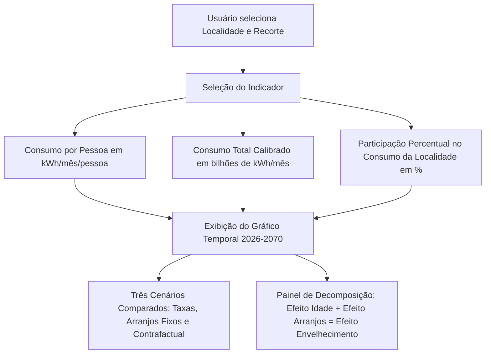
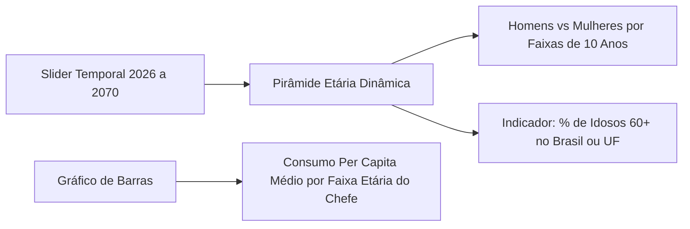

# Guia do Usuário — Como Utilizar o PROCED

O PROCED é uma aplicação web rica e responsiva, desenvolvida em React e estruturada em páginas acessíveis através de abas no cabeçalho ou por rotas baseadas em *hash* (`#pan`, `#dom`, `#eta`, `#sim`, `#comp`).

Este guia explica detalhadamente o funcionamento de cada módulo, como manipular os filtros, como realizar simulações prospectivas e como exportar os dados gerados.

---

## 1. Visão Geral da Interface

Ao abrir o PROCED (por padrão em `http://localhost:5173`), o usuário é recebido com uma barra superior contendo:

1. **Logo e Título do Sistema:** PROCED — Projeção de Consumo por Estrutura Demográfica.
2. **Navegação Principal (Abas):**
   * **Panorama:** Visão macro temporal de 2026 a 2070 e decomposição analítica dos efeitos.
   * **Domicílios:** Padrões de consumo e distribuição dos 6 arranjos domiciliares.
   * **Estrutura Etária:** Pirâmide etária dinâmica e perfil de consumo por idade do chefe.
   * **Simulador:** Motor interativo para testar combinações específicas de faixa etária e arranjo.
   * **Comparar:** Ferramenta analítica para confrontar de 2 a 6 grupos simultaneamente.
3. **Filtro Global de Localidade:**
   * Permite alternar entre **Brasil**, as **5 Macrorregiões** (Norte, Nordeste, Centro-Oeste, Sudeste, Sul) e as **27 Unidades da Federação** (UFs).
   * Todos os gráficos, tabelas e cálculos reagem instantaneamente à localidade selecionada.
4. **Gaveta de Fontes e Metodologia:**
   * Botão no canto superior direito que abre uma gaveta lateral (*drawer*) contendo a lista oficial das fontes do IBGE, a cobertura amostral calculada, a lista de premissas ativas e o link direto para a documentação.

---

## 2. Módulo 1: Panorama Prospectivo (`#pan`)

O módulo **Panorama** é o centro analítico da aplicação. Ele responde à pergunta: *Como o consumo residencial de energia elétrica evoluirá entre 2026 e 2070 sob diferentes cenários de envelhecimento e mudança de arranjos domiciliares?*

### 2.1. Controles e Seletores

* **Recorte Analítico:**
  * `Todos os domicílios`: Avalia a totalidade dos lares do Brasil ou da localidade. É o único recorte onde tanto o efeito da idade quanto o efeito dos arranjos atuam simultaneamente.
  * `Chefe 60+ (todos os arranjos)`: Isola os domicílios chefiados por pessoas com 60 anos ou mais. Evidencia predominantemente a transição entre arranjos dentro da população idosa.
  * `Chefe 60+ (apenas mononucleares)`: Domicílios de idosos morando sós ou em casal/dupla.
  * `Abaixo de 60 (apenas mononucleares)`: Domicílios de chefes jovens ou adultos morando sós ou em dupla.
* **Indicadores Disponíveis:**
  1. **Consumo por pessoa (kWh/mês/pessoa):** Média real obtida dividindo-se o consumo total pelo volume de moradores projetados (TBC padronizada).
  2. **Consumo total calibrado (bilhões de kWh/mês):** Consumo agregado da localidade, calibrado pela população oficial recenseada pelo IBGE.
  3. **Participação no consumo residencial (%):** Representatividade do recorte selecionado em relação ao total residencial da localidade.

### 2.2. Os Três Cenários Exibidos no Gráfico

1. **Envelhecimento e arranjos (`taxas`):** Cenário principal. Combina o envelhecimento populacional com a tendência histórica comprovada de proliferação de domicílios unipessoais e casais sem dependentes (Premissa P13).
2. **Só o envelhecimento (`taxas_arranjos_fixos`):** Isola apenas o impacto da mudança na distribuição etária, mantendo congeladas as proporções de arranjo observadas em 2026.
3. **Sem mudanças desde 2026 (`contrafactual`):** Cenário de controle contrafactual. O número de domicílios segue o crescimento populacional, mas a distribuição etária e os arranjos familiares ficam rigidamente congelados no padrão de 2026.

### 2.3. Painel de Decomposição dos Efeitos

Ao lado ou abaixo do gráfico, o sistema exibe os cartões com a decomposição analítica exata:

$$\Delta_{\text{envelhecimento}} = \Delta_{\text{idade}} + \Delta_{\text{arranjos}}$$

* **Efeito Idade:** Mede quanto do aumento do consumo decorre exclusivamente do aumento de pessoas idosas na população.
* **Efeito Arranjos:** Mede o consumo adicional provocado pela menor densidade de moradores por domicílio (perda da economia de escala coletiva).
* **Efeito Envelhecimento Total:** A soma exata dos dois efeitos.

---

## 3. Módulo 2: Composição dos Domicílios (`#dom`)

Este módulo explora a estrutura interna das famílias brasileiras e sua evolução histórica e projetada.

### O que você encontra nesta tela:

1. **Tabela dos 6 Perfis Domiciliares:**
   * Domicílios Unipessoais com chefe de 60+ anos.
   * Domicílios de Casal ou Dupla com chefe de 60+ anos.
   * Domicílios Multipessoais (3 ou mais moradores) com chefe de 60+ anos.
   * Domicílios Unipessoais com chefe abaixo de 60 anos.
   * Domicílios de Casal ou Dupla com chefe abaixo de 60 anos.
   * Domicílios Multipessoais com chefe abaixo de 60 anos.
2. **Métricas Apresentadas:**
   * **Consumo Per Capita na POF (kWh/mês/pessoa):** Mostra a forte disparidade: enquanto um domicílio multipessoal jovem consome cerca de 45 a 55 kWh/pessoa, um idoso vivendo sozinho consome em média mais de 105 a 115 kWh/mês!
   * **Amostra da POF:** Número de domicílios entrevistados na localidade.
   * **Casas a cada 100 domicílios:** Proporção percentual calculada para cada ano entre 2026 e 2070.
   * **Mini Histórico Visual (*Sparklines*):** Gráficos em linha miniaturizados que revelam se a categoria está crescendo, estável ou em declínio estrutural.

---

## 4. Módulo 3: Estrutura Etária & Pirâmides (`#eta`)

Este módulo conecta a demografia pura ao comportamento de consumo elétrico.

### Funcionalidades:

* **Slider Temporal da Pirâmide Etária:** Arraste o seletor de 2026 a 2070 para ver a pirâmide etária brasileira mudar de formato, estreitando na base (queda de nascimentos) e alargando substancialmente no topo (grupo de 80+ anos quadruplicando).
* **Consumo por Faixa Etária do Chefe:** Gráfico em barras interativo demonstrando o padrão de consumo per capita conforme o chefe envelhece:
  * Até 29 anos
  * 30 a 39 anos
  * 40 a 49 anos
  * 50 a 59 anos
  * 60 a 69 anos
  * 70 a 79 anos
  * 80 anos ou mais
* **Seletor de Arranjo Familiar no Consumo:** Permite filtrar se o gráfico de barras exibirá apenas mononucleares, unipessoais, casais ou a média geral.

---

## 5. Módulo 4: Simulador Interativo (`#sim`)

O **Simulador** permite ao usuário explorar cenários customizados e analisar células sociodemográficas com precisão milimétrica.

### Como realizar uma simulação:

1. **Escolha a Célula de Interesse:**
   * **Faixa etária do chefe:** Escolha uma das 7 faixas etárias.
   * **Tipo de arranjo:** Unipessoal, Casal ou Dupla, ou Multipessoal.
2. **Defina o Ano Alvo:** Selecione qualquer ano entre 2026 e 2070.
3. **Ajuste os Controles de Simulação (RF02):**
   * **Velocidade do Envelhecimento ($k$):** Varia de 0.5 a 1.5 (padrão 1.0). Permite testar cenários onde o envelhecimento ocorre mais rápido ($k > 1.0$) ou mais lentamente ($k < 1.0$) do que o projetado pelo IBGE.
   * **Intensidade da Tendência dos Arranjos:** Varia de 0.0 a 1.5 (padrão 0.6). Um valor 0.0 congela as proporções de arranjos a partir de 2026; valores maiores aceleram a transição para domicílios unipessoais e casais.
4. **Selecione o Cenário Base:** `taxas` (recomendado), `taxas_arranjos_fixos` ou `contrafactual`.
5. **Resultado da Simulação:**
   * A aplicação exibe instantaneamente o volume de **domicílios projetados**, a **participação relativa**, o **consumo per capita** da célula e o **consumo total mensal calibrado**.
   * Quando uma combinação já foi simulada anteriormente, ela é recuperada com o selo `recuperado: true` da tabela `cenario_salvo` do banco de dados (RF09). Caso você deseje forçar um recálculo, basta clicar em "Recalcular".

---

## 6. Módulo 5: Comparador Multigrupos (`#comp`)

O módulo **Comparar** foi concebido para análises comparativas avançadas entre múltiplos segmentos domiciliares (RF12).

### Passos para uso:

1. **Adicionar Grupos à Comparação:**
   * Clique em "Adicionar grupo" e selecione de 2 a 6 grupos diferentes.
   * Estão disponíveis tanto as 6 células elementares (`uni_60`, `cas_60`, `mul_60`, `uni_59`, `cas_59`, `mul_59`) quanto grupos agregados consolidados (`mono_60`, `mono_59`, `todos_60`, `todos_59`).
2. **Escolha o Indicador Comparativo:**
   * `domicilios`: Quantidade total de residências projetadas.
   * `consumo_total`: Consumo energético total mensal calibrado (bilhões de kWh).
   * `participacao`: Percentual de representatividade no consumo da localidade.
   * `consumo_por_pessoa`: Média individual em kWh/mês/pessoa (disponível para grupos agregados).
3. **Escolha o Formato da Visualização:**
   * **Modo Índice (2026 = 100):** Padroniza todos os grupos com valor base 100 em 2026, facilitando identificar visualmente qual grupo tem o crescimento percentual mais acelerado.
   * **Modo Absoluto:** Mostra os valores reais em unidades físicas (casas, kWh ou bilhões de kWh).
4. **Tabela Ranqueada:**
   * Exibe automaticamente os valores para 2026, 2050 e 2070, com a variação percentual calculada e a ordem de crescimento classificada (ranking de 1º a 6º colocado).

---

## 7. Módulo 6: Exportação de Dados e Relatórios (`/exportar`)

O PROCED oferece exportação integral de dados para continuidade dos estudos em ferramentas estatísticas externas (R, Python, Stata) ou planilhas eletrônicas (Excel, LibreOffice).

### Como exportar:

1. No Panorama, clique no botão **"Exportar Dados"**.
2. No Comparador, clique no botão **"Exportar Comparação"**.
3. Escolha as opções no diálogo de exportação:
   * **Formato do Arquivo:**
     * **XLSX (Microsoft Excel):** Recomendado para análise em planilhas. Já vem estruturado, sem problemas de codificação e com colunas numéricas tipadas.
     * **CSV (Valores Separados por Vírgula):** Codificado em UTF-8 com BOM (*Byte Order Mark*), garantindo que acentuações em português sejam abertas nativamente pelo Excel sem corrupção de caracteres.
   * **Escopo:**
     * `Ano Atual`: Exporta a fotografia pontual do ano selecionado.
     * `Série Completa (2026 a 2070)`: Exporta a série histórica contínua de 45 anos.
4. **Metadados Incluídos:** Cada arquivo exportado inclui automaticamente carimbo de data/hora (ISO 8601), versão oficial do motor de cálculo (`VERSAO_MODELO`), tamanho amostral da POF, controles $k$ e intensidade empregados e indicador de simulação.

---

## 8. Interpretação de Avisos e Regras de Confiabilidade

Para manter o rigor estatístico em níveis amostrais pequenos (especialmente ao selecionar UFs com baixa densidade populacional, como Roraima ou Amapá):

* **Alerta de Baixa Confiabilidade (`baixa_confiabilidade: true`):**
  * Ocorre quando qualquer célula sociodemográfica envolvida no cálculo possui **menos de 30 domicílios observados** na amostra da POF.
  * A interface exibe um ícone de advertência para alertar o usuário de que aquela média per capita possui margem de erro estatístico mais ampla.
* **Motivo Sem Valor (`motivo_sem_valor`):**
  * Caso uma localidade não possua nenhum domicílio amostrado em determinada faixa etária (ex: chefe com mais de 80 anos vivendo só em determinada UF na amostra da POF), o sistema devolve `null` com a justificativa técnica explícita, evitando imputações arbitrárias.
