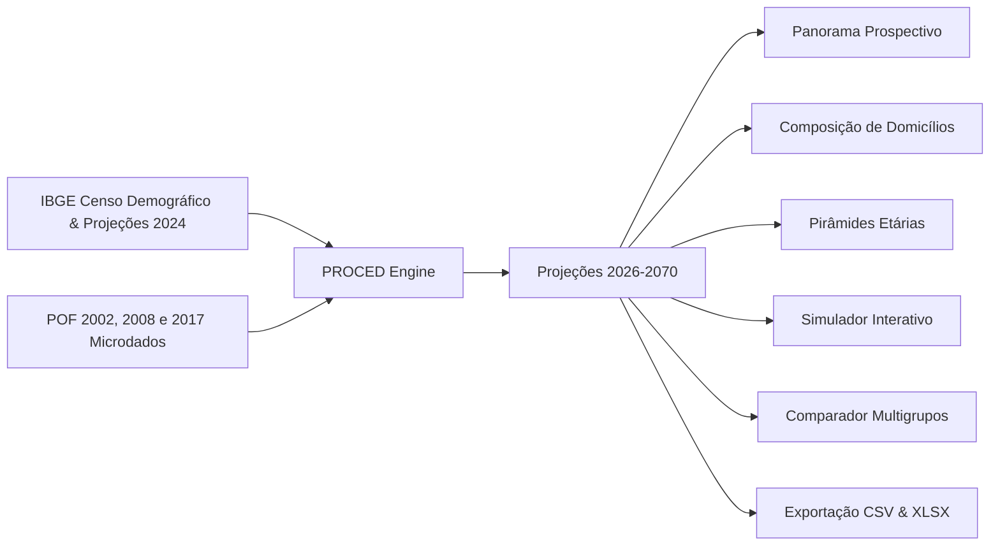

# PROCED-TCC — Projeção de Consumo por Estrutura Demográfica

Bem-vindo à documentação oficial do **PROCED** (**P**rojeção de Consumo por **E**strutura **D**emográfica), uma plataforma analítica desenvolvida para projetar e decompor o impacto do envelhecimento populacional e da transição dos arranjos familiares sobre o consumo residencial de energia elétrica no Brasil, no horizonte de **2026 a 2070**.

---

## 1. O que é o PROCED?

O PROCED é uma aplicação web completa (frontend interativo em React + backend analítico em FastAPI + banco relacional em nuvem Supabase PostgreSQL) que combina microdados amostrais de pesquisas domiciliares oficiais do IBGE com projeções demográficas de longo prazo.

Através de formulações demográficas rigorosas (padronização direta de taxas, método de chefia por idade e modelos de transição de arranjos familiares), o PROCED permite estimar não apenas o consumo elétrico residencial agregado do país, mas isolar analiticamente:

1. **Quanto do consumo decorre estritamente da mudança na pirâmide de idades** (Efeito Idade).
2. **Quanto decorre da fragmentação dos lares em estruturas menores** como domicílios unipessoais e casais sem filhos (Efeito Arranjos).
3. **Qual é o efeito sinérgico total do envelhecimento populacional** (Efeito Envelhecimento).

---

## 2. Para que utilizar o PROCED?

O planejamento energético tradicional brasileiro baseia-se historicamente em premissas macroeconômicas correlacionadas ao PIB, expansão de renda e taxa de crescimento da população total. Contudo, o Brasil atravessa uma das mais rápidas transições demográficas do planeta: a taxa de fecundidade caiu para patamares abaixo do nível de reposição e o ápice populacional brasileiro ocorrerá por volta de 2042 a 2048, seguido de um rápido declínio demográfico.

O PROCED foi construído para responder às seguintes questões centrais:

* **O consumo residencial cairá quando a população começar a encolher?**
  * *Resposta da modelagem:* Não necessariamente no mesmo ritmo. O envelhecimento demográfico acarreta a proliferação de domicílios menores (lares de idosos morando sozinhos ou em dupla). Como aparelhos de uso coletivo (geladeira, iluminação, televisão, roteador) não são divididos entre muitos moradores, o consumo per capita desses domicílios é consideravelmente superior, contrabalançando a redução populacional.
* **Quem deve utilizar o PROCED?**
  * **Empresa de Pesquisa Energética (EPE) & Ministério de Minas e Energia (MME):** Para calibração dos Planos Decenais de Expansão de Energia (PDE) e do Plano Nacional de Energia (PNE 2050), inserindo a variável de transição de arranjos nos modelos de demanda.
  * **Operador Nacional do Sistema Elétrico (ONS) & CCEE:** Para antecipação do perfil de carga residencial e planejamento de despacho de geração.
  * **Distribuidoras de Energia Elétrica:** Para dimensionamento de rede, previsão de novos pontos de conexão (já que o número de domicílios cresce até quase 2060) e gestão de perdas.
  * **Pesquisadores e Formuladores de Políticas Públicas:** Para estudos de pobreza energética, tarifas sociais e eficiência de eletrodomésticos para o público da terceira idade.

---

## 3. Principais Destaques dos Resultados (2026 a 2070)

Os dados gerados pelo PROCED revelam dinâmicas estruturais que desafiam intuições simplistas:

| Indicador Demográfico / Energético | 2026 (Ano Base) | 2050 (Pós-Pico Pop.) | 2070 (Horizonte Final) | Variação Global |
|---|---|---|---|---|
| **População Residente (IBGE)** | 214,21 milhões | 218,37 milhões | 199,23 milhões | $-7,0\%$ vs 2026 ($-8,8\%$ vs pico) |
| **Domicílios Projetados** | 72,39 milhões | 90,20 milhões | 88,13 milhões | **$+21,7\%$** |
| **Consumo por Pessoa (Média Real)** | 60,58 kWh/mês | 66,70 kWh/mês | 71,40 kWh/mês | **$+17,9\%$** |
| **TBC Padronizada** | 71,54 kWh/mês | 78,52 kWh/mês | 82,68 kWh/mês | **$+15,6\%$** |
| **Consumo Residencial Calibrado** | 12,98 bi kWh/mês | 14,57 bi kWh/mês | 14,23 bi kWh/mês | **$+9,6\%$** |

> [!IMPORTANT] O Paradoxo do Consumo Residencial no Declínio Populacional
> Entre 2050 e 2070, o Brasil perderá mais de **19 milhões de habitantes**. No entanto, o número de domicílios residenciais reduz-se em apenas **2 milhões**, mantendo-se **15,7 milhões acima do nível de 2026**. Como resultado, o consumo total de energia elétrica residencial em 2070 (14,23 bilhões de kWh/mês) ainda será quase **10% superior ao de 2026**, sustentado pela transição dos arranjos familiares.

---

## 4. Estrutura da Plataforma e Navegação

A documentação está dividida nas seguintes seções temáticas:

1. **[Guia do Usuário](guia-usuario.md):** Manual completo de utilização das 6 telas da interface web (Panorama, Domicílios, Estrutura Etária, Simulador, Comparação e Exportação).
2. **[Arquitetura do Sistema](arquitetura.md):** Visão arquitetural, diagramas de blocos, ciclo de vida de requisições, modelo de cache assíncrono em memória e padrões de projeto.
3. **[Decisões Técnicas](decisoes-tecnicas.md):** Registro formal de escolhas arquiteturais, ferramentas (FastAPI, React, Vite, Supabase) e benchmarks de latência (RNF02).
4. **[Engenharia de Dados & Pipeline ETL](etl.md):** Passo a passo minucioso de engenharia de dados (Fases 1 a 6), fontes oficiais, critérios de exclusão, ponderação amostral e modelagem de Machine Learning.
5. **[Scripts de Execução](scripts.md):** Documentação detalhada dos scripts SQL no BigQuery e scripts Python de migração.
6. **[Banco & Dicionário de Dados](dicionario-dados.md):** Diagrama Entidade-Relacionamento e especificação completa dos campos, tipos e regras das 9 tabelas no Supabase.
7. **[Metodologia Científica & Fórmulas](metodologia.md):** Modelagem matemática formal com equações em LaTeX, padronização direta da TBC, decomposição de efeitos, calibração populacional e validação temporal.
8. **[Quadro de Premissas (P1 a P14)](premissas.md):** Lista exaustiva das 14 premissas metodológicas adotadas no projeto, com fontes e impactos no cálculo.
9. **[Resultados & Cenários](resultados.md):** Apresentação aprofundada das tabelas prospectivas, análises de sensibilidade e conclusões empíricas.
10. **[Contrato da API REST](contrato-api.md):** Especificação completa dos endpoints OpenAPI/Swagger do backend FastAPI.
11. **[Instalação & Desenvolvimento](desenvolvimento.md):** Instruções práticas para clonar, configurar variáveis de ambiente, executar backend, frontend, testes automatizados e deploy no GitHub Pages.
