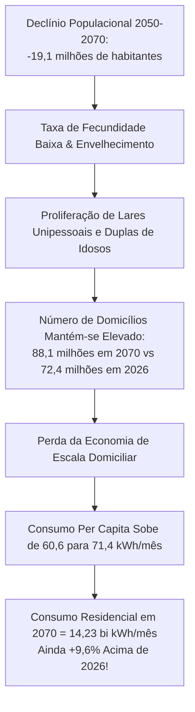

# Resultados, Cenários e Descobertas

Este documento apresenta e analisa os resultados quantitativos gerados pelo **PROCED** para o Brasil no horizonte prospectivo de **2026 a 2070**. Todos os valores decorrem da execução do motor demográfico (`backend/etl/pipeline.py`), calibrados pela revisão 2024 das projeções de população do IBGE e parametrizados pelos microdados da POF.

---

## 1. Tabela Síntese dos Cenários Oficiais (2026 a 2070)

A tabela abaixo sintetiza a trajetória dos indicadores principais para os anos de referência do estudo no cenário nacional (`todos_domicilios`, Brasil):

| Ano | Cenário | TBC Padronizada (kWh/mês/p) | Consumo por Pessoa (kWh/mês) | Domicílios Projetados | População IBGE | Consumo Total Calibrado (bi kWh/mês) | Consumo Total (GWh/mês) |
|---|---|---|---|---|---|---|---|
| **2026** | *Todos* | **71,54** | **60,58** | 72,39 milhões | 214,21 milhões | **12,98** | 12.977 |
| **2030** | `taxas` | 72,70 | 61,59 | 76,46 milhões | 216,42 milhões | 13,33 | 13.330 |
| **2040** | `taxas` | 75,56 | 64,09 | 84,98 milhões | 218,85 milhões | 14,03 | 14.025 |
| **2050** | `taxas` (Principal) | **78,52** | **66,70** | **90,20 milhões** | **218,37 milhões** | **14,57** | **14.566** |
| 2050 | `taxas_arranjos_fixos` | 74,94 | 63,15 | 90,20 milhões | 218,37 milhões | 13,79 | 13.791 |
| 2050 | `contrafactual` | 71,54 | 60,58 | 90,20 milhões | 218,37 milhões | 13,23 | 13.229 |
| **2060** | `taxas` | 80,95 | 69,27 | 90,75 milhões | 211,28 milhões | 14,64 | 14.636 |
| **2070** | `taxas` (Principal) | **82,68** | **71,40** | **88,13 milhões** | **199,23 milhões** | **14,23** | **14.225** |
| 2070 | `taxas_arranjos_fixos` | 76,79 | 64,58 | 88,13 milhões | 199,23 milhões | 12,87 | 12.866 |
| 2070 | `contrafactual` | 71,54 | 60,58 | 88,13 milhões | 199,23 milhões | 12,07 | 12.069 |

---

## 2. A Decomposição dos Três Efeitos

Ao comparar os três cenários no ano de **2050** e no ano de **2070**, evidencia-se o poder explicativo da decomposição analítica:

### Decomposição no Ano de 2050 (Ápice do Consumo)

* **Efeito Idade:**
  $$\text{TBC: } 74,94 - 71,54 = \mathbf{+3,40\text{ kWh/mês/pessoa}}$$
  $$\text{Consumo Agregado: } 13,79 - 13,23 = \mathbf{+0,56\text{ bilhão de kWh/mês}}$$
* **Efeito Arranjos:**
  $$\text{TBC: } 78,52 - 74,94 = \mathbf{+3,58\text{ kWh/mês/pessoa}}$$
  $$\text{Consumo Agregado: } 14,57 - 13,79 = \mathbf{+0,78\text{ bilhão de kWh/mês}}$$
* **Efeito Envelhecimento Global:**
  $$\text{TBC: } 78,52 - 71,54 = \mathbf{+6,98\text{ kWh/mês/pessoa (+9,8\%)}}$$
  $$\text{Consumo Agregado: } 14,57 - 13,23 = \mathbf{+1,34\text{ bilhão de kWh/mês (+10,1\%)}}$$

> [!NOTE] Destaque Metodológico
> Em 2050, o **Efeito Arranjos** supera o **Efeito Idade** puro (+0,78 bi kWh vs +0,56 bi kWh). Isto demonstra que a fragmentação dos lares em estruturas familiares menores possui um peso energético superior ao simples fato biológico do envelhecimento dos indivíduos!

### Decomposição no Ano de 2070 (Horizonte Final)

* **Efeito Idade:** $+5,25\text{ kWh/mês/pessoa}$ ($+0,80\text{ bilhão de kWh/mês}$).
* **Efeito Arranjos:** $+5,89\text{ kWh/mês/pessoa}$ ($+1,36\text{ bilhão de kWh/mês}$).
* **Efeito Envelhecimento Global:** $+11,14\text{ kWh/mês/pessoa}$ ($+2,16\text{ bilhões de kWh/mês}$).

---

## 3. O Paradoxo do Consumo no Declínio Demográfico

Uma das contribuições centrais deste estudo é a elucidação do comportamento do consumo de energia durante a fase de decrescimento demográfico brasileiro:

Se o planejamento energético nacional assumisse uma correlação direta simples entre população total e demanda residencial (como no cenário `contrafactual`), projetaria um consumo de apenas **12,07 bilhões de kWh/mês** em 2070. 

A modelagem do PROCED revela que a demanda real sustentada será de **14,23 bilhões de kWh/mês** — uma diferença de **2,16 bilhões de kWh/mês a mais** (equivalente à geração média contínua de duas usinas hidrelétricas de porte médio).

---

## 4. Análise de Sensibilidade

### 4.1. Sensibilidade da Intensidade da Tendência dos Arranjos ($\lambda$)
O arquivo `backend/etl/saida/sensibilidade_intensidade.csv` avalia a evolução da demanda para diferentes intensidades de transição dos arranjos (Premissa P13):

* **$\lambda = 0.0$ (Congelamento dos Arranjos a partir de 2026):**
  * TBC em 2050: $74,94\text{ kWh/mês/p}$ | Consumo Calibrado: $13,79\text{ bi kWh/mês}$.
  * TBC em 2070: $76,79\text{ kWh/mês/p}$ | Consumo Calibrado: $12,87\text{ bi kWh/mês}$.
* **$\lambda = 0.6$ (Intensidade Calibrada Padrão):**
  * TBC em 2050: $78,52\text{ kWh/mês/p}$ | Consumo Calibrado: $14,57\text{ bi kWh/mês}$.
  * TBC em 2070: $82,68\text{ kWh/mês/p}$ | Consumo Calibrado: $14,23\text{ bi kWh/mês}$.
* **$\lambda = 1.0$ (Tendência Histórica sem Amortecimento):**
  * TBC em 2050: $81,03\text{ kWh/mês/p}$ | Consumo Calibrado: $15,11\text{ bi kWh/mês}$.
  * TBC em 2070: $86,81\text{ kWh/mês/p}$ | Consumo Calibrado: $15,17\text{ bi kWh/mês}$.

### 4.2. Sensibilidade da Cobertura Amostral da POF (Fator 1,082)
Conforme registrado em `backend/etl/saida/sensibilidade_cobertura.csv`, a exclusão de domicílios sem kWh declarado na extração da POF cobre 92,4% dos lares brasileiros (Premissa P9).

* Se aplicarmos o fator de reexpansão $1,082$ sobre o consumo **bruto não calibrado**, o consumo total estimado em 2026 passaria de 11,81 para 12,78 bilhões de kWh/mês.
* Contudo, graças à **Calibração Populacional (Premissa P12)** adotada pelo PROCED, o consumo total divulgado na aplicação não depende deste fator, pois é calibrado matematicamente pela população oficial do IBGE.
