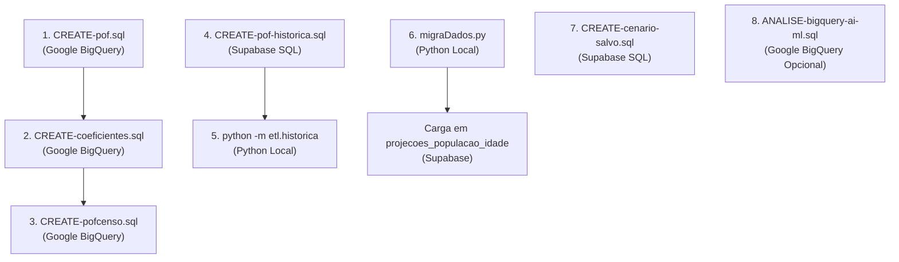

# Scripts do Processo de ETL e Migração

Este documento cataloga todos os scripts SQL e Python versionados no diretório [`docs/scripts/`](https://github.com/M4RINH0/PROCED-TCC/tree/main/docs/scripts), detalhando a ordem lógica de execução, os ambientes necessários, os parâmetros de entrada e as saídas esperadas.

---

## 1. Visão Geral e Ordem de Execução

Para reproduzir a extração de dados e as cargas analíticas do zero, siga rigorosamente a sequência abaixo:

---

## 2. Detalhamento dos Scripts

### 2.1. `CREATE-pof.sql`
* **Ambiente:** Google BigQuery.
* **Objetivo:** Cria a tabela principal `fato_consumo_domiciliar`.
* **Descrição da Lógica:**
  * Conecta às tabelas públicas `basedosdados.br_ibge_pof.despesa_coletiva_2017` e `basedosdados.br_ibge_pof.morador_2017`.
  * Filtra o código de item `600101` para isolar estritamente o gasto físico com energia elétrica (`V9005` em kWh) e o valor pago em R$ (`V8000_deflacionado`).
  * Realiza `JOIN` entre morador e despesa pela chave `id_domicilio`.
  * Filtra apenas chefes de família (`V0306 IN ('01', '1')`) e agrega o consumo de eventuais múltiplas unidades de consumo via `SUM(V9005)`.
  * Extrai o fator de expansão populacional `peso_final` da POF 2017-2018.
  * Realiza `SAFE_CAST` e tratamento de strings com `TRIM()`.

---

### 2.2. `CREATE-coeficientes.sql`
* **Ambiente:** Google BigQuery.
* **Objetivo:** Gera a tabela analítica de lookup `dim_coeficiente_consumo` (162 linhas).
* **Descrição da Lógica:**
  * Agrupa a tabela `fato_consumo_domiciliar` por Unidade da Federação (`sigla_uf`), arranjo familiar (`Unipessoal`, `Casal ou Dupla`, `Multipessoal`) e idade do chefe (`is_60_mais`).
  * Calcula as contagens amostrais (`COUNT(*)`) e as médias aritméticas simples de consumo total, consumo per capita e gasto financeiro.
* **Status no Sistema Operacional:** Script exploratório de baseline. A tabela gerada não é consumida pela API nem pelo pipeline de projeções, que calculam médias ponderadas com `peso_final` e 7 faixas etárias diretamente sobre `fato_consumo_domiciliar`.

---

### 2.3. `CREATE-pofcenso.sql`
* **Ambiente:** Google BigQuery.
* **Objetivo:** Gera a tabela estadual `consumo_estimado` do Ano Base 2022.
* **Descrição da Lógica:**
  * Cruza os microdados da tabela `basedosdados.br_ibge_censo_2022.municipio` com os coeficientes de consumo per capita da POF.
  * Calcula a população total e a população idosa recenseada em cada uma das 27 UFs em 2022.
  * Estima o montante mensal de consumo elétrico atribuível a idosos e a não idosos por estado.
* **Status no Sistema Operacional:** Script exploratório do Ano Base 2022. O motor analítico do PROCED projeta a série contínua 2026–2070 sem depender desta tabela.

---

### 2.4. `CREATE-pof-historica.sql`
* **Ambiente:** PostgreSQL no Supabase (SQL Editor).
* **Objetivo:** Cria a estrutura da tabela `fato_consumo_pof_historica`.
* **Descrição da Lógica:**
  * Define colunas harmonizadas entre as edições da POF 2002-2003 e 2008-2009: `ano_pof`, `sigla_uf`, `id_domicilio`, `qtd_moradores`, `arranjo_familiar`, `idade_chefe`, `is_60_mais`, `consumo_total_kwh`, `consumo_per_capita_kwh`, `peso_final`, `kwh_imputado` e `energia_rede_geral`.
  * Cria a chave primária composta `(ano_pof, id_domicilio)`.
  * Habilita Row Level Security (RLS) sem políticas públicas, restringindo acesso à chave de serviço do backend.

---

### 2.5. `CREATE-cenario-salvo.sql`
* **Ambiente:** PostgreSQL no Supabase (SQL Editor).
* **Objetivo:** Cria a tabela `cenario_salvo` para persistência e recuperação de simulações interativas do Simulador (RF09).
* **Estrutura:**
  * `id`: Chave primária UUID ou serial.
  * `parametros`: Coluna `jsonb` contendo a combinação exata de `(ano, localidade, faixa, arranjo, base, intensidade, k)`.
  * `resultado`: Coluna `jsonb` armazenando a resposta serializada da simulação.
  * `versao_modelo`: String de versionamento (ex: `"2026-10-14"`).
  * `criado_em` e `atualizado_em`: Timestamps de auditoria.
  * `UNIQUE (parametros, versao_modelo)`: Índice único para evitar duplicidades e garantir busca instantânea em $O(1)$.

---

### 2.6. `ANALISE-bigquery-ai-ml.sql`
* **Ambiente:** Google BigQuery.
* **Objetivo:** Script analítico avançado contendo rotinas de BigQuery AI & ML:
  * Exploração estatística de dados via `ML.DESCRIBE_DATA`.
  * Detecção de valores atípicos e anomalias de consumo com `AI.DETECT_ANOMALIES`.
  * Identificação de determinantes de consumo energético via `AI.KEY_DRIVERS`.
  * Treinamento e avaliação de regressores `BOOSTED_TREE_REGRESSOR` nativos no BigQuery integrando características físicas do domicílio e renda familiar.

---

### 2.7. `migraDados.py`
* **Ambiente:** Python 3.11+ (Local).
* **Objetivo:** Processamento das planilhas brutas de projeções demográficas do IBGE (Revisão 2024).
* **Descrição da Lógica:**
  * Carrega a planilha oficial com a população por idade simples (0 a 90+) e sexo (Homens, Mulheres, Ambos) de 2000 a 2070.
  * Aplica transformação de *melt/unpivot* para transpor as colunas anuais em registros verticais.
  * Padroniza nomes de localidades e siglas de UFs.
  * Exporta o arquivo `projecoes_normalizadas_pronto.csv` com 639.639 linhas para importação no Supabase.
